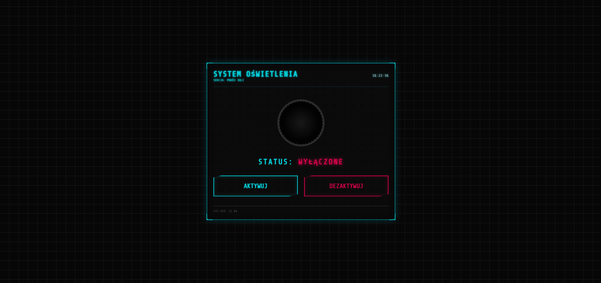
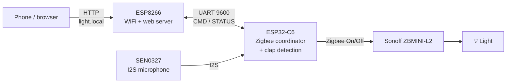
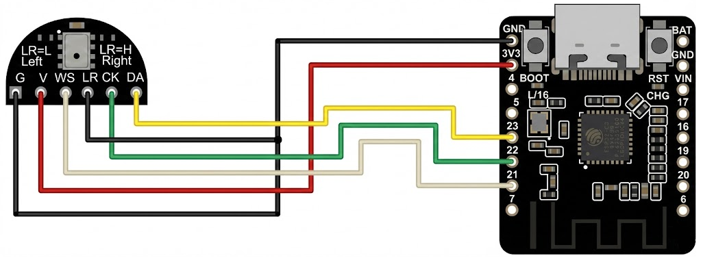

# Zigbee Light Controller (Dual MCU Edition)

[](https://github.com/bartek03m/esp32c6-zigbee-light-controller/actions/workflows/build.yml)


[](LICENSE)

Turn the lights on and off by **clapping three times** or from a **web page on your phone**.
An **ESP32-C6** detects claps and drives a Sonoff Zigbee relay, while an **ESP8266** hosts the web UI. The two boards talk over UART. Everything runs locally, with no cloud and no hub.



## The "Why"

I built this because my girlfriend, Jula, is too lazy to get out of bed to turn off the lights (well, I'm too lazy too). Now she can just clap three times and boom, darkness. If clapping is too much effort, she can also control it via a Web Interface from her phone.

## Features

- **Clap control:** three claps within 5 seconds toggle the light.
- **Web control:** cyberpunk-themed page at `http://light.local`, kept in sync with clap toggles.
- **Zigbee coordinator on the ESP32-C6:** talks directly to the Sonoff, no Zigbee hub needed.
- **One-time pairing:** the paired device is saved in flash and survives reboots.
- **Reliable commands:** IEEE unicast with 3 retries and a mutex, so the audio task and web commands never collide.
- **Simple HTTP API:** `/on`, `/off`, `/status`, easy to call from scripts or other home automation tools.

## Architecture



The work is split across two boards so the Zigbee radio and the audio processing never compete with WiFi on the same chip.

| Board | Role |
| --- | --- |
| **ESP32-C6** (DFRobot Beetle) | Zigbee coordinator, I2S microphone, clap detection |
| **ESP8266** (NodeMCU v2) | WiFi, mDNS (`light.local`), web server |

## Hardware

- DFRobot Beetle ESP32-C6
- ESP8266 NodeMCU v2
- DFRobot SEN0327 I2S MEMS microphone
- Sonoff ZBMINI-L2 (Zigbee relay, no neutral wire required)
- Jumper wires

## Wiring

### Microphone → ESP32-C6



| SEN0327 | ESP32-C6 |
| --- | --- |
| V | 3V3 |
| G | GND |
| WS | GPIO 21 |
| CK | GPIO 22 |
| DA | GPIO 23 |
| LR | GND (left channel) |

### ESP32-C6 ↔ ESP8266 (UART)

| ESP32-C6 | ESP8266 (NodeMCU) |
| --- | --- |
| GPIO 4 (TX) | RX (GPIO 3) |
| GPIO 5 (RX) | TX (GPIO 1) |
| GND | GND |

Both boards use 3.3 V logic, so no level shifter is needed. Power each board over USB (or from a shared 5 V supply). **The GND connection between the boards is required.**

### Sonoff ZBMINI-L2

> [!WARNING]
> The Sonoff works with mains voltage (110 V / 230 V). Switch off power at the breaker before installing it behind the wall switch or near the light fitting. If you are not sure what you are doing, ask an electrician.

## Getting Started

### Requirements

- [VS Code](https://code.visualstudio.com/) with the [PlatformIO](https://platformio.org/) extension
- Each firmware folder is a separate PlatformIO project, so open them one at a time.

### 1. ESP8266 (web server / WiFi)

1. Open the `esp8266-firmware` folder in PlatformIO.
2. Copy `include/Secrets.example.h` to `include/Secrets.h` and enter your WiFi `ssid` and `password`.
   `Secrets.h` is ignored by git, so your password stays local.
3. **Disconnect the wire on the ESP8266 RX pin** (the USB-serial chip uses the same pin during upload).
4. Build and upload, then reconnect the wire.

### 2. ESP32-C6 (Zigbee / clap detection)

1. Open the `esp32c6-firmware` folder in PlatformIO.
2. Optionally adjust the audio constants in `include/Constants.h` (see [Tuning](#tuning)).
3. Build and upload.

## Usage

### Pairing the Sonoff (one time)

1. Power on or reset the ESP32-C6.
2. **Right after the reset, press and hold BOOT for about 3 seconds.**
   Do not hold it while the board powers up. BOOT is GPIO 9, a strapping pin, and holding it at power-on puts the chip into download mode.
3. The on-board LED (GPIO 15) lights up. The Zigbee network is now open for **180 seconds**.
4. Put the Sonoff ZBMINI-L2 into pairing mode (hold its button for ~5 s, or flip the wall switch on and off several times).
5. When the LED turns off, the window is closed. The serial log shows `Device BOUND!` and the device address is saved to flash.

On every normal boot the saved device is loaded automatically.

### Clap control

Clap **3 times within 5 seconds** to toggle the light. After a toggle, claps are ignored for 1.5 seconds.

### Web control

Open `http://light.local` on a device in the same network and press **AKTYWUJ** (on) or **DEZAKTYWUJ** (off).
The page polls the light state every 2 seconds, so it also reflects clap toggles.

### HTTP API

| Endpoint | Response | Action |
| --- | --- | --- |
| `GET /` | HTML | Web UI |
| `GET /on` | `OK` | Turn the light on |
| `GET /off` | `OK` | Turn the light off |
| `GET /status` | `1` / `0` | Current light state |

```bash
curl http://light.local/on
curl http://light.local/status
```

## UART Protocol

Plain text lines, 9600 baud, 8N1, terminated with `\n`.

| Direction | Message | Meaning |
| --- | --- | --- |
| ESP8266 → ESP32-C6 | `CMD:ON` / `CMD:OFF` | Switch the light |
| ESP32-C6 → ESP8266 | `STATUS:ON` / `STATUS:OFF` | New light state (after a clap or a command) |

The ESP8266 also prints its debug logs on the same UART. The ESP32-C6 ignores every line that does not start with `CMD:`.

## Tuning

| Constant | Where | Default | Effect |
| --- | --- | --- | --- |
| `micSensitivity` | `esp32c6-firmware/src/Globals.cpp` | `8000` | Loudness threshold. Raise it if background noise counts as claps. |
| `SILENCE_DEBOUNCE` | `esp32c6-firmware/include/Constants.h` | `60` ms | Silence needed to end a clap |
| `MAX_CLAP_DURATION` | `esp32c6-firmware/include/Constants.h` | `200` ms | Longer sounds are treated as noise |
| `MAX_SEQUENCE_TIME` | `esp32c6-firmware/include/Constants.h` | `5000` ms | Time window for all 3 claps |
| `TOGGLE_COOLDOWN` | `esp32c6-firmware/src/AudioLogic.cpp` | `1500` ms | Pause after a toggle |
| Zigbee channel | `esp32c6-firmware/src/ZigbeeLogic.cpp` | `25` | Zigbee radio channel |

## Project Structure

```
├── esp32c6-firmware/        # Zigbee coordinator + clap detection
│   ├── include/Constants.h  # Pins and audio constants
│   ├── src/AudioLogic.cpp   # I2S microphone, clap detection task
│   ├── src/ZigbeeLogic.cpp  # Pairing, ON/OFF commands
│   ├── src/UartComm.cpp     # UART link to the ESP8266
│   └── partitions.csv       # Flash layout with Zigbee storage
├── esp8266-firmware/        # WiFi + web server
│   ├── include/Secrets.example.h
│   ├── src/WebLogic.cpp     # WiFi, mDNS, web UI, HTTP endpoints
│   └── src/UartComm.cpp     # UART link to the ESP32-C6
└── docs/                    # Images used in this README
```

## Troubleshooting

- **PlatformIO on Windows: "path too long".** Set `PLATFORMIO_CORE_DIR` to a short path like `C:\pio`, or enable long paths in the Windows Registry.
- **ESP8266 upload fails.** Disconnect the wire on the ESP8266 RX pin during upload.
- **`No saved device — hold BOOT on next start to pair!` in the log.** The Sonoff is not paired yet. Follow [Pairing the Sonoff](#pairing-the-sonoff-one-time).
- **The board ends up in download mode instead of pairing.** BOOT was held while powering up. Press it only after the reset.
- **`light.local` does not open.** Some Android devices do not support mDNS. Use the IP address printed in the ESP8266 serial log.

## Software Stack

- **Platform:** PlatformIO (VS Code)
- **Framework:** Arduino (ESP32 Arduino Core 3.x via pioarduino, ESP8266 Arduino Core)
- **Hardware:** ESP32-C6 (RISC-V) & ESP8266
- **Connectivity:** UART, Zigbee (ZBOSS stack) & WiFi

> Note: The web interface was generated by AI and slightly modified by me. This allowed me to focus fully on the C++ logic, Zigbee communication, and hardware integration.

## License

[MIT](LICENSE) © 2026 Bartosz Majewski

---
*Built by Bartek.*
